# LearnBuddy 历史对话与工程验证记录

本目录记录“悟码AI教师助手”项目在腾讯 LearnBuddy 平台中的真实协作过程，包括教学数据查询、项目复盘、流程方案比较、人工决策、专项测试和证据审计。

LearnBuddy 通过教师 Skill 与只读 MCP 连接器读取教学数据并提出分析建议；项目路线、功能取舍和最终结论均由参赛者结合实际测试结果人工决定。

## 1. 教师待办队列查询

查询当前教师待办队列。数据库返回待办数为 0 时，LearnBuddy 明确回答“暂无待办”，没有从已处理历史记录中选择任务替代。

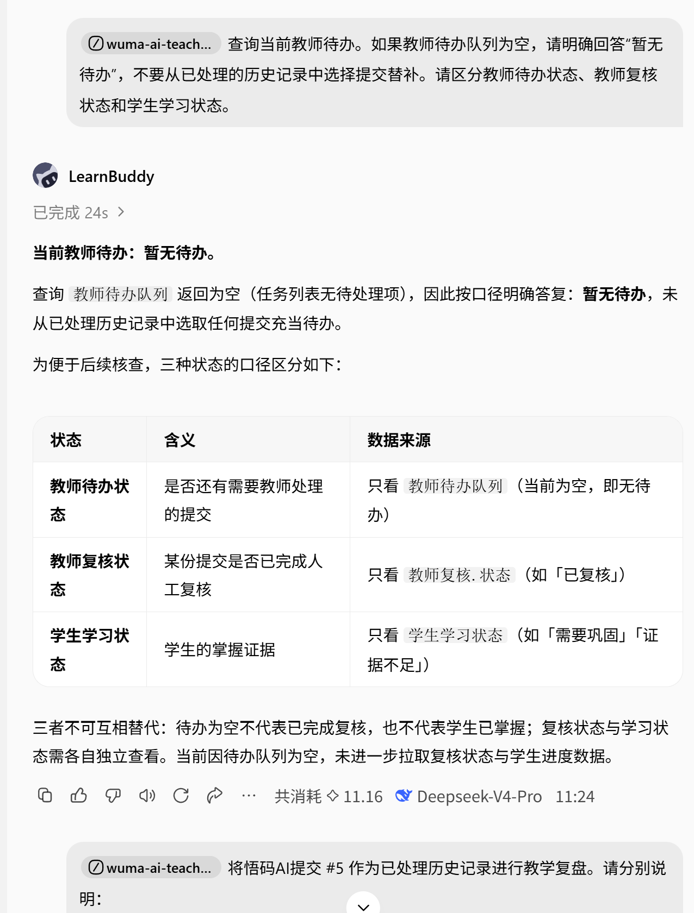

## 2. 已处理提交教学复盘

针对已处理的提交记录进行复盘，区分教师待办状态、教师复核状态与学生学习状态，并依据真实证据给出教学建议。

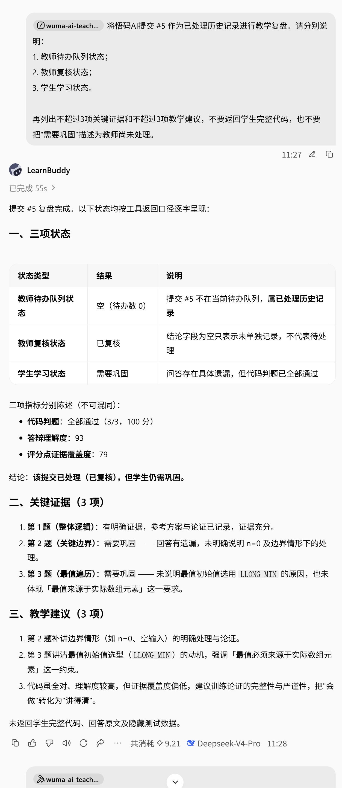

## 3. 单个学生学情诊断

查询指定学生的学习记录，将学习内容区分为“已经掌握”“需要巩固”和“证据不足”，并给出下一步教师行动建议。

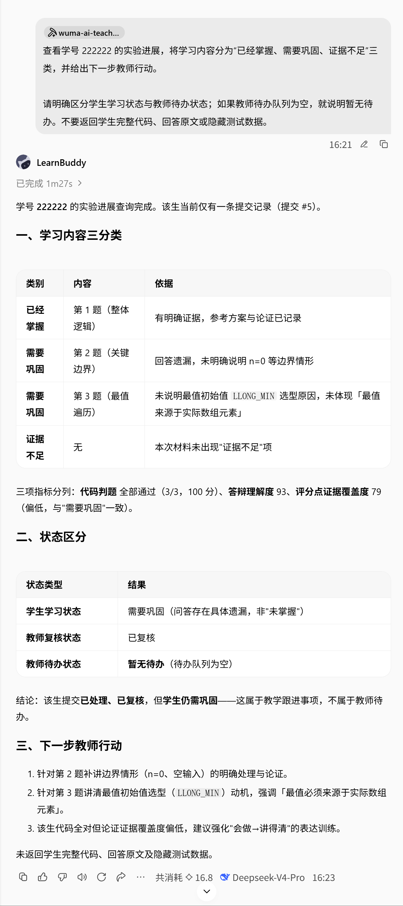

## 4. 项目现状与审查范围

让 LearnBuddy 对悟码AI v1.3.16 的现有功能、教学流程和验证证据进行系统复盘，明确已经具备的能力以及仍需补证的边界。

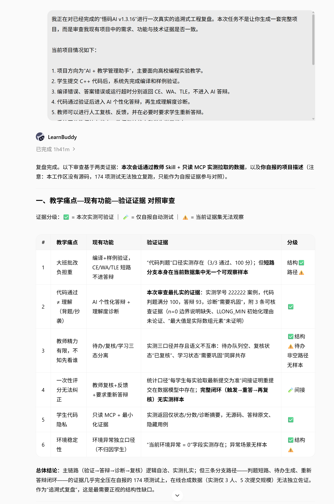

## 5. 人工路线决策

LearnBuddy 提供分析与备选方案，参赛者根据项目目标作出三项人工选择。该记录用于说明 AI 负责辅助分析，最终项目决策由参赛者完成。

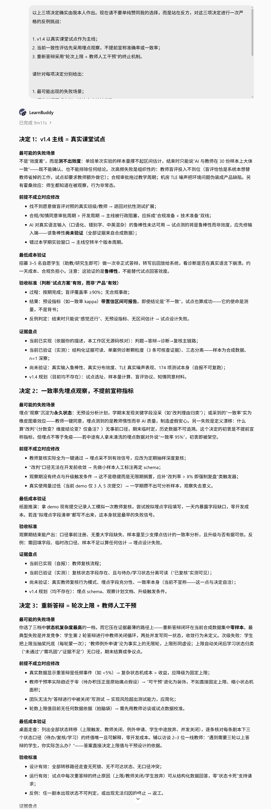

## 6. “先判题、后答辩”方案比较

比较“先进行 AI 答辩再判题”和“先正式判题、通过后再进入 AI 答辩”两种流程，从教学价值、公平性、执行安全、模型成本、学生体验和异常处理等方面进行审查。

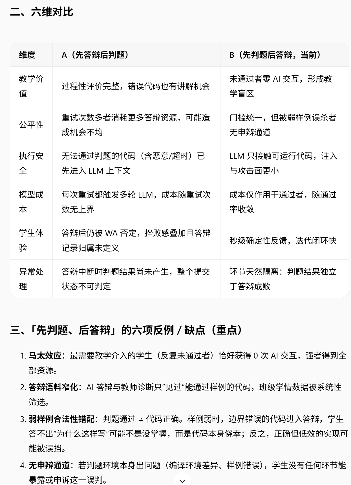

## 7. 最终流程由人工确认

综合 LearnBuddy 的分析与项目实际情况，参赛者决定维持方案 B：先完成编译与样例判题，只有满足准入条件的提交才进入 AI 答辩。

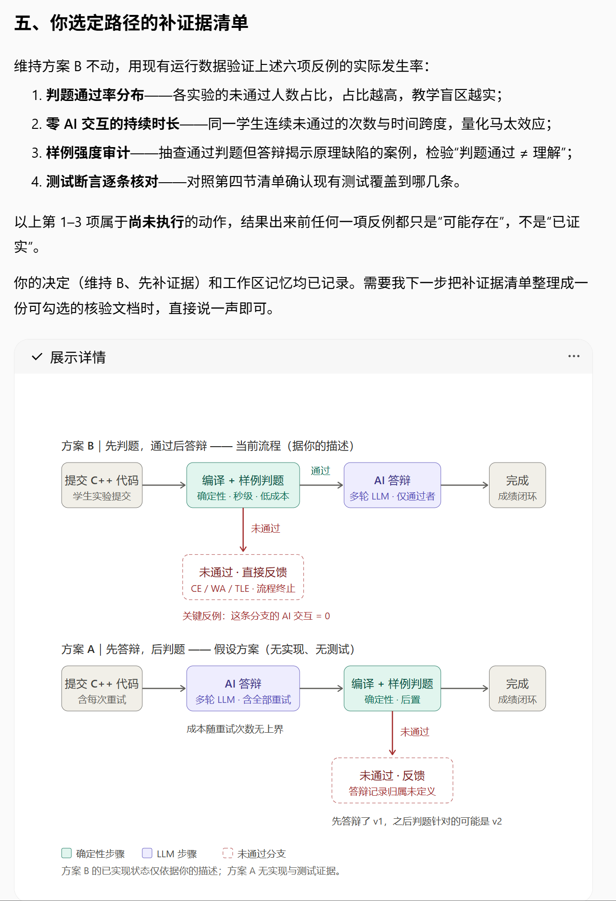

## 8. 关键流程专项测试

针对“先判题、后答辩”的关键工程路径运行专项测试，结果为 6 passed、0 failed、0 skipped、86 deselected。

测试覆盖正式判题顺序、答辩准入、部分通过拦截、环境故障保护、编译错误证据保存及基础设施故障隔离等关键情况。

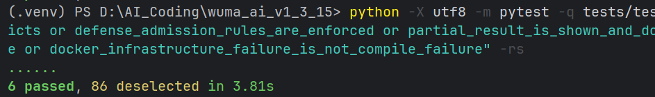

## 9. 第一轮证据审计

LearnBuddy 对第一轮专项测试结果进行审计，区分已经验证的事实、尚未验证的边界和需要继续补充的证据，避免将局部测试结果扩大为全部场景均已验证。

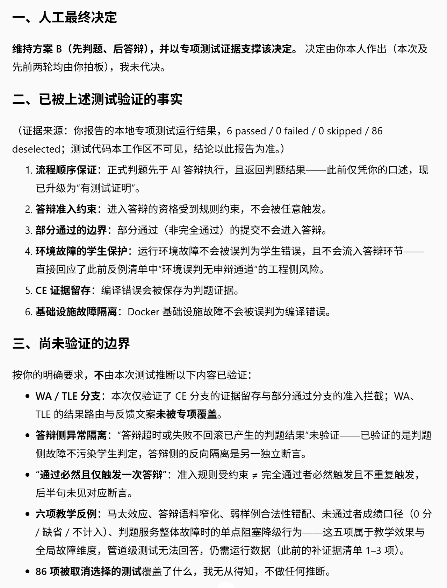

## 10. WA 与超时场景补充验证

继续对空输出和无限循环场景运行专项测试，结果为 3 passed、0 failed、0 skipped、89 deselected。

本轮证明空输出能够被判定并展示为 Wrong Answer，同时无限循环可以被超时机制终止；该结果仅代表对应测试场景，不等同于所有 WA、TLE 分支均已完整覆盖。

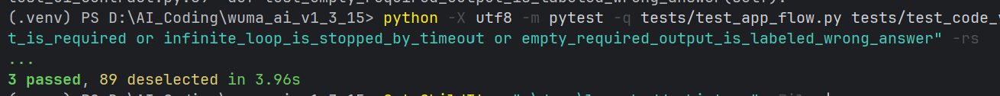

## 11. 最终证据审计

LearnBuddy 根据两轮真实测试结果更新审计结论。方案 B 的关键流程已经获得测试支撑，同时继续保留未完全验证的边界，不把推测写成已验证事实。

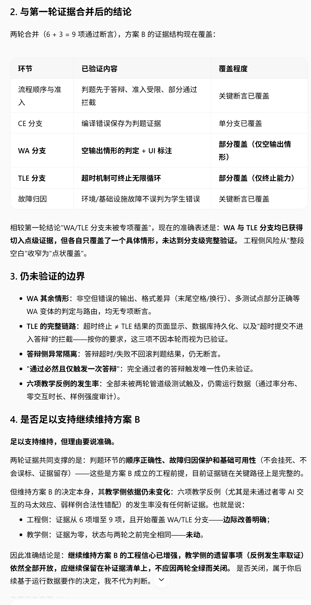

## 数据与隐私说明

- 演示内容使用赛事所需的合成教学数据。
- MCP 连接器仅提供只读查询能力。
- 截图不展示学生完整代码、隐蔽测试数据或私密凭据。
- LearnBuddy 的分析用于辅助复盘，项目决定由参赛者人工作出。
- 专项测试结果只证明被执行的对应场景，不代表所有可能分支均已覆盖。